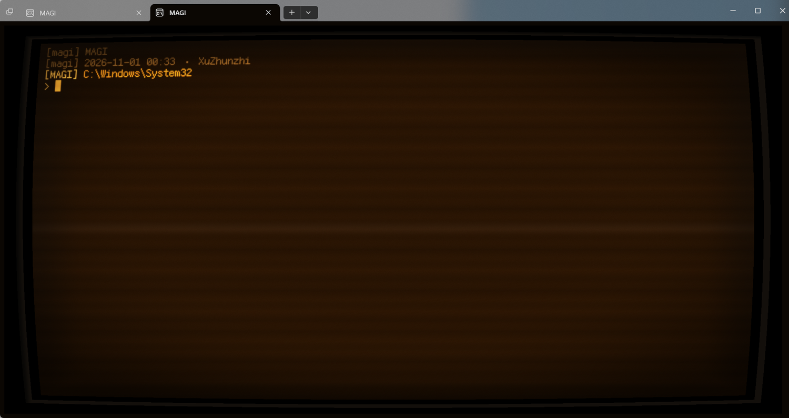

# MAGI — an EVA/NERV CRT terminal for Windows Terminal

Amber CRT look for Windows Terminal: a pixel shader that bends the screen, draws
scanlines and phosphor glow, the Ark Pixel bitmap font, a matching colour scheme,
and a one-shot PowerShell script that applies all of it to `settings.json`.

Everything is driven by [`scripts/setup-magi-terminal.ps1`](scripts/setup-magi-terminal.ps1):
idempotent, backs up before writing, and leaves your other profiles alone.



---

## Origin and attribution

This repository is **not** an original work. It is an extraction of the Windows
Terminal half of a much larger EVA skin collection, so that the CRT terminal can be
installed without pulling in the Hermes Agent skins it also ships with.

| Upstream | What was taken | Licence |
| --- | --- | --- |
| [Chael-Chael/awesome-hermes-eva-skins](https://github.com/Chael-Chael/awesome-hermes-eva-skins) | `shaders/*.hlsl`, the `Cool Retro Amber` colour scheme, the profile appearance settings | MIT, © 2026 Chenyu Zhu |
| [microsoft/terminal — samples/PixelShaders](https://github.com/microsoft/terminal/tree/main/samples/PixelShaders) | `Retro.hlsl`, which the shaders are based on | MIT |
| [Hammster/windows-terminal-shaders](https://github.com/Hammster/windows-terminal-shaders) | the surrounding shader workflow | CC0-1.0 |
| [TakWolf/ark-pixel-font](https://github.com/TakWolf/ark-pixel-font) | the Ark Pixel 12px mono font family used by the profiles | SIL OFL 1.1 |

The full text of those notices lives in [THIRD_PARTY_NOTICES.md](THIRD_PARTY_NOTICES.md).
If you redistribute or modify the shaders, keep them.

The profile names (`MAGI`, `MAGI·AMBER`) and this installer script are the only parts
written for this repository.

The upstream repository ships its own `scripts/install-windows.ps1`, which is a
different (and much larger) installer covering the Hermes Agent half as well. Two
first-run bugs in that script — `settings.json` written with `schemes` as an object
instead of an array, and the bundled fonts copied but never loaded — were fixed
upstream in
[Chael-Chael/awesome-hermes-eva-skins#1](https://github.com/Chael-Chael/awesome-hermes-eva-skins/pull/1).
This repository's script was written around the same problem and is not affected by
either.

---

## What you get

Two Windows Terminal profiles that share one amber CRT look:

| Profile | Shader | Use it for |
| --- | --- | --- |
| `MAGI` | `cool-retro-frame-lite.hlsl` | everyday work — keeps most of the original hues, 20 texture taps/pixel |
| `MAGI·AMBER` | `cool-retro-frame-amber-lite.hlsl` | screenshots, recording, NERV monochrome vibes — maps almost everything to amber |

Plus:

* colour scheme `Cool Retro Amber`
* `Shift+F10` toggles the shader, `Shift+F11` toggles focus mode
* `compatibility.ambiguousWidth: wide` — see [CJK punctuation](#cjk-punctuation) below
* the default profile is set to `MAGI`
* the profiles launch `pwsh.exe -NoLogo`, so the engine banner does not sit above
  whatever your `$PROFILE` prints

## Performance

The upstream shader blurs the terminal texture with a 13x13 Gaussian to get the
phosphor glow. That is 169 texture taps per pixel, plus a `GetDimensions` query
per pixel and 169 `exp()` calls, on top of the base sample and the chromatic
aberration:

| Work per pixel | Upstream `readable` | This repo's `lite` |
| --- | --- | --- |
| source sample | 1 | 1 |
| chromatic aberration | 2 | 2 |
| glow | **169** (13x13 Gaussian) | **17** (centre + two 8-tap rings) |
| hot phosphor trail | 2 | 0 (switchable) |
| **total taps** | **174** | **20** |

`cool-retro-frame-lite.hlsl` keeps the frame, scanlines, vignette, grain, refresh
line, amber mapping, colour preservation and a box-blur glow — at roughly 1/9th
of the texture bandwidth. It also reads `Resolution` from the constant buffer
instead of calling `GetDimensions`, and has no per-sample `exp()`.

`cool-retro-frame-amber-lite.hlsl` is the same treatment for the amber profile. It
has no colour preservation (everything converges on the phosphor), a wider glow
ring to match the amber shader's larger blur sigma, and stronger chromatic
aberration — same 20 taps.

Pass `-FullShader` to keep the upstream 174-tap shaders instead. Either way both
flavours are installed, so you can switch by editing
`experimental.pixelShaderPath` on the profile, or press `Shift+F10` to turn the
shader off entirely and compare.

## Requirements

* Windows 11 with Windows Terminal **1.26 or newer** for the punctuation fix.
  1.24 and older ignore `compatibility.ambiguousWidth` and curly quotes will
  overlap the neighbouring character.
* PowerShell 7 (`pwsh.exe`) is what the profiles launch. It resolves via `PATH`.

## Install

```powershell
git clone https://github.com/xuzhunzhi/magi-terminal.git
cd magi-terminal

# see what would change, write nothing
powershell -NoProfile -ExecutionPolicy Bypass -File .\scripts\setup-magi-terminal.ps1 `
    -FontSource <path\to\fonts> -DryRun

# apply
powershell -NoProfile -ExecutionPolicy Bypass -File .\scripts\setup-magi-terminal.ps1 `
    -FontSource <path\to\fonts>
```

`-FontSource` points at a directory containing the four
`ark-pixel-12px-monospaced-*.ttf` files. They are ~20 MB together and are therefore
not committed here; grab them from
[`TakWolf/ark-pixel-font` releases](https://github.com/TakWolf/ark-pixel-font/releases)
or from the upstream repository above. If the fonts are already registered for your
user, you can omit `-FontSource` entirely and pass `-SkipFonts`.

The shaders ship with this repository, so no download is needed for those.

### Options

| Flag | Effect |
| --- | --- |
| `-Target All\|Stable\|Preview` | which Windows Terminal package to patch (default `All`, missing ones skipped) |
| `-SettingsPath <file>` | patch that `settings.json` instead of the installed packages |
| `-FontSource <dir>` | directory holding the four Ark Pixel TTFs |
| `-SkipFonts` / `-SkipShaders` | skip those steps |
| `-FullShader` | use the upstream 174-tap `readable` shader instead of the 20-tap `lite` one |
| `-KeepDefaultProfile` | do not change `defaultProfile` |
| `-DryRun` | print the plan, write nothing |

Every modified `settings.json` gets a `settings.json.bak-<timestamp>` sibling; roll
back by copying it over the original.

## What the script changes

For each target `settings.json`, keyed by GUID so repeated runs update instead of
duplicating:

* upserts profiles `MAGI` (`{c50c5efb-…-e7df259a1399}`) and `MAGI·AMBER`
  (`{64d9f64b-…-a86c8cb20f74}`)
* upserts the `Cool Retro Amber` scheme
* adds `Terminal.ToggleShaderEffects` on `Shift+F10` and `Terminal.ToggleFocusMode`
  on `Shift+F11` — skipped if the key combination is already taken
* sets `compatibility.ambiguousWidth` to `wide`
* points `defaultProfile` at `MAGI`

It also copies the shaders to `%LOCALAPPDATA%\WindowsTerminalShaders` and installs
the fonts per-user — writing the `HKCU` font entries **and** calling
`AddFontResource`, because per-user fonts are otherwise only picked up at the next
sign-in and Windows Terminal reports them as missing straight after installation.

## CJK punctuation

`Ark Pixel` draws `“ ” ‘ ’` one em wide. Those code points are East-Asian
*ambiguous* width, so a terminal that defaults to `narrow` gives them a single cell
and the glyph spills into the next character. `compatibility.ambiguousWidth: wide`
fixes it — and needs Windows Terminal 1.25+, i.e. the Preview package today.

## Credits

Designed and authored upstream by
[Chael-Chael](https://github.com/Chael-Chael) and the contributors of
`awesome-hermes-eva-skins`. Go star that repository — the skins, the fonts, the
braille banner tooling and the shaders all come from there.

## Docs

- [`docs/wt-fork-crt.md`](docs/wt-fork-crt.md) — design and progress for turning a
  Windows Terminal fork into a whole-window CRT monitor: the sidebar-as-a-pane
  approach, the upstream code that has to change, the build toolchain, and the
  network restrictions on this machine.
- [`scripts/MagiPrompt.ps1`](scripts/MagiPrompt.ps1) — the shell side of the setup
  (prompt, greeting, UTF-8 console fix, `uu` helper). Copy it to
  `~/Documents/PowerShell/` and dot-source it from your profile.
